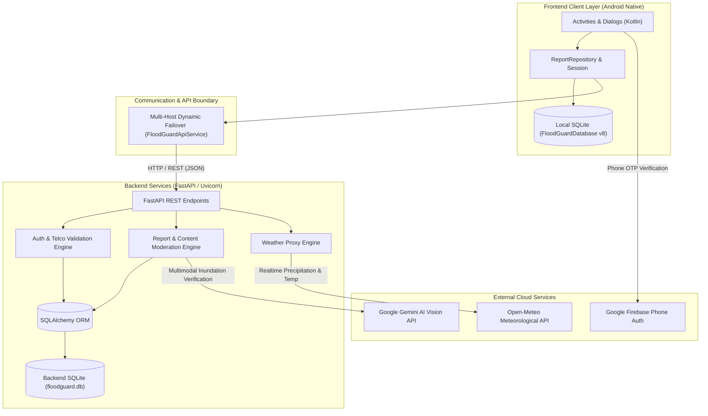
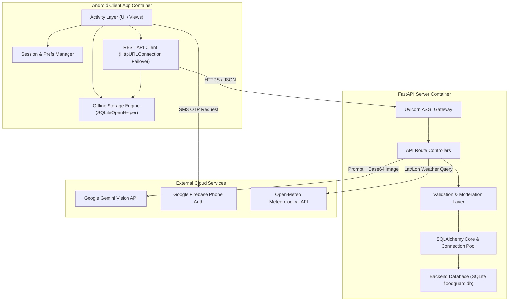
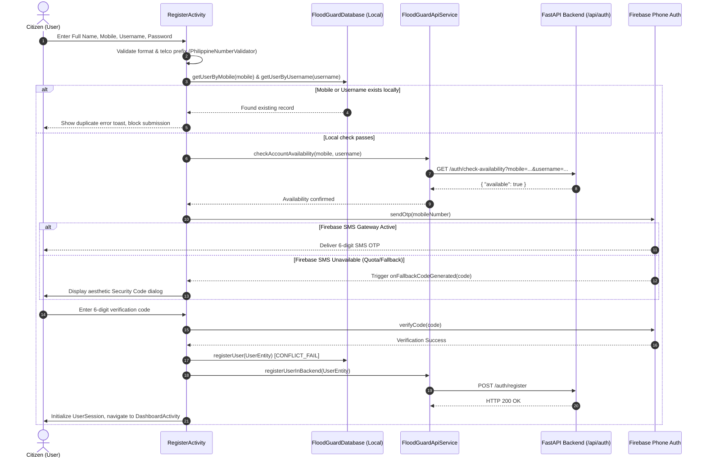
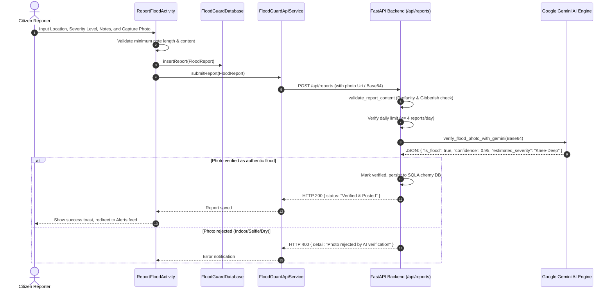
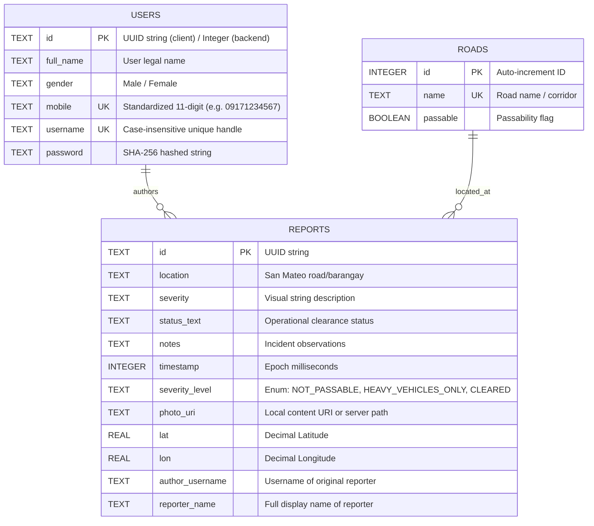
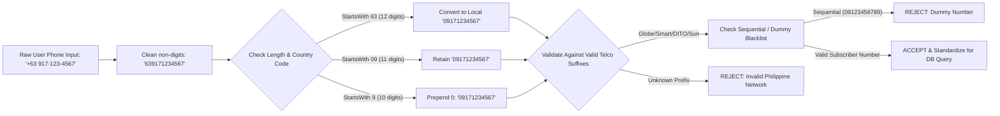

# FloodGuard: Comprehensive System Architecture & Technical Delivery Guide

> **Target Audience**: Lead Backend Engineer, Lead Frontend Engineer (Android), Database Administrator (DBA), System Analyst, and UML Solutions Architect.  
> **Repository**: [Floodguard-app](https://github.com/KenJin0407/Floodguard-app)  
> **Target Deployment**: Android Native App (Kotlin, Min SDK 24 / Target SDK 34) & Python FastAPI Microservices.

---

## 1. Executive System Overview

**FloodGuard** is a community-driven, real-time flood monitoring, alerting, and reporting platform specifically engineered for flood-vulnerable municipalities (primarily modeled around San Mateo, Rizal, Philippines).

The platform bridges citizen crowdsourcing with automated verification by combining:
1. **Offline-First Android Client**: Fully autonomous local SQLite database caching, responsive map visualization via OpenStreetMap/Leaflet, and background sync.
2. **FastAPI High-Performance Backend**: RESTful microservice managing user authentication, road network states, incident lifecycles, and weather feeds.
3. **Multimodal AI Flood Verification**: Integration with Google Gemini Vision API to authenticate crowd-submitted flood photos before marking reports verified.
4. **Resilient Identity & Telecom Integration**: Strict Philippine E.164 / local 11-digit mobile validation (`09xx`, `+639xx`), Firebase Phone Authentication with automatic local fallback, and unique mobile identity enforcement.



### Detailed Explanation of Figure 1: High-Level End-to-End System Flowchart

* **Purpose & Scope**:
  Figure 1 illustrates the overall topological flow of data across the three core runtime tiers of FloodGuard: the Android client environment, the FastAPI application server, and external third-party cloud services.
* **Component Breakdown**:
  * **Frontend Client Layer**: Contains native Android user interfaces (`Activities & Dialogs`) interacting with [`ReportRepository`](file:///c:/Users/kevin/Desktop/Floodguard-app-main/app/src/main/java/com/example/floodguard/ReportRepository.kt) for in-memory caching and [`FloodGuardDatabase`](file:///c:/Users/kevin/Desktop/Floodguard-app-main/app/src/main/java/com/example/floodguard/FloodGuardDatabase.kt) (v8) for permanent on-device SQLite storage.
  * **Network Communication Boundary**: Governed by [`FloodGuardApiService`](file:///c:/Users/kevin/Desktop/Floodguard-app-main/app/src/main/java/com/example/floodguard/FloodGuardApiService.kt), which uses a multi-host failover list (`HOST_URLS`) to cycle through reachable server IPs (emulator, local Wi-Fi hotspot, and production).
  * **Backend Microservice Layer**: Built on FastAPI and Uvicorn. Decouples into three dedicated processing engines: (1) `Auth & Telco Engine`, (2) `Report & Moderation Engine`, and (3) `Weather Proxy Engine`. All persistence runs through SQLAlchemy ORM targeting `floodguard.db`.
  * **External Cloud Services**: Google Gemini Vision handles automated visual flood assessment; Firebase provides mobile SMS authentication; and Open-Meteo supplies live precipitation and temperature metrics.
* **Architectural Rationale**:
  Disaster management applications must withstand severe network instability. By isolating the client layer with a local SQLite engine and providing multi-host fallback, the app maintains zero-latency reading and reporting even when field cellular signals fluctuate.
* **Stakeholder Presentation Highlights**:
  * *For System Analysts*: Emphasize the end-to-end data lifecycle—from a citizen capturing a photo to server-side AI verification and broadcast to neighboring users.
  * *For Lead Frontend*: Highlight that UI components never directly make raw HTTP calls; all operations flow through `ReportRepository` to ensure cache-first synchronization.
  * *For Lead Backend*: Highlight how FastAPI routes delegate heavy work (image verification, external weather) cleanly to specialized service engines without blocking the event loop.

---

## 2. System Analyst Perspective

### 2.1 Core Functional Requirements & Business Rules

| Domain | Business Rule / Requirement | Enforcement Mechanism |
| :--- | :--- | :--- |
| **User Identity** | Each registered user must possess a strictly unique Philippine phone number. No duplicate registrations allowed under any telecom prefix variant (`+63`, `09`, `63`). | Standardized via [`PhilippineNumberValidator.standardize()`](file:///c:/Users/kevin/Desktop/Floodguard-app-main/app/src/main/java/com/example/floodguard/PhilippineNumberValidator.kt) on client and `normalize_ph_mobile()` on backend. Enforced by SQLite `UNIQUE` constraints and unique indexes. |
| **Crowdsourced Reporting** | Users can report flood levels: `Ankle-Deep`, `Knee-Deep`, `Waist-Deep`, `Chest-Deep`, or `Impassable`. Maximum 4 reports per user per calendar day. | Rate limited in backend (`MAX_DAILY_REPORTS = 4`) and tracked in Android client [`UserSession.kt`](file:///c:/Users/kevin/Desktop/Floodguard-app-main/app/src/main/java/com/example/floodguard/UserSession.kt). |
| **Photo Verification** | Reports must include photographic evidence. The photo is evaluated by AI to detect actual outdoor floodwater, submerged streets, or waterlogged roads. | Backend pipeline [`verify_flood_photo_with_gemini()`](file:///c:/Users/kevin/Desktop/Floodguard-app-main/backend/main.py#L55-L106) sends image to Gemini Vision API; rejects selfies, pets, indoors, or dry roads. |
| **Content Moderation** | Location names and incident notes must not contain Tagalog or English profanity, random keyboard spam, or nonsensical gibberish. | Checked via `PROFANITY_WORDS` blacklist and `is_gibberish_text()` vowel/consonant distribution regex heuristics. |
| **Incident Lifecycle** | Community reports remain permanently in history, while dynamic map hazard circles expire after 24 hours to prevent cluttering the operational map view. | Local query filter checking `timestamp >= (now - 24h)` for map overlays, while full report cards remain in local/remote databases. |
| **Notification Behavior** | Notification popups are silenced for the report author to prevent redundancy. Other users within or near the hazard zone receive smooth staggered alert cards. | Managed in [`FloatingAlertManager.kt`](file:///c:/Users/kevin/Desktop/Floodguard-app-main/app/src/main/java/com/example/floodguard/FloatingAlertManager.kt) with author username filtering and a 1.8-second launch delay. |

### 2.2 Offline Resilience Strategy
- When offline, Android users can view cached road states and previously fetched community alerts.
- New reports and profile edits are committed locally to SQLite.
- Background sync routines attempt delivery across configured local hotspot IPs (`192.168.x.x`) and production base URLs.

---

## 3. UML Solutions Architect Perspective

### 3.1 C4 Container Diagram
The platform is organized into three major operational tiers:



### Detailed Explanation of Figure 2: C4 Container Diagram

* **Purpose & Scope**:
  Figure 2 breaks down the system at C4 Level 2 (Container Level), depicting each runtime container, its internal architectural responsibilities, and the inter-container communication protocols.
* **Component Interactions**:
  * **Android Client App Container**: Runs as a compiled standalone APK. Activities handle user input and event dispatching. The `Session & Prefs Manager` ([`UserSession.kt`](file:///c:/Users/kevin/Desktop/Floodguard-app-main/app/src/main/java/com/example/floodguard/UserSession.kt)) holds encrypted session state. The `REST API Client` communicates asynchronously with the backend, writing incoming payloads into the local `Offline Storage Engine` ([`FloodGuardDatabase.kt`](file:///c:/Users/kevin/Desktop/Floodguard-app-main/app/src/main/java/com/example/floodguard/FloodGuardDatabase.kt)).
  * **FastAPI Server Container**: Hosted inside an ASGI server environment (Uvicorn). `Uvicorn` receives raw HTTP/JSON requests, routing them to specific `API Route Controllers`. Payloads are strictly sanitized by the `Validation & Moderation Layer` before reaching `SQLAlchemy Core`, which maintains a pooled connection to `floodguard.db`.
  * **External Cloud Services**: External dependencies are isolated through standard JSON APIs over HTTPS.
* **Architectural Rationale**:
  Container separation ensures high cohesion and low coupling. Changes in backend database technologies (e.g. migrating from SQLite to PostgreSQL) or AI providers (upgrading Gemini versions) require zero changes to the Android client container's interfaces.
* **Stakeholder Presentation Highlights**:
  * *For UML Architects*: Show how this container model aligns with modern cloud-ready microservice principles.
  * *For DBAs*: Point out that both containers feature local databases: an embedded SQLite instance on Android client devices for offline autonomy, and a centralized server-side SQLite instance behind SQLAlchemy connection pooling.

---

### 3.2 Sequence Diagram: Registration with Identity & OTP Verification



### Detailed Explanation of Figure 3: User Registration & OTP Verification Sequence

* **Purpose & Scope**:
  Figure 3 traces the step-by-step chronology of account creation, highlighting the multi-layered verification strategy that guarantees unique phone identity and zero registration drop-offs.
* **Step-by-Step Flow**:
  1. **Steps 1–2 (Client-Side Input & Telco Filtering)**: The user submits registration fields. [`PhilippineNumberValidator`](file:///c:/Users/kevin/Desktop/Floodguard-app-main/app/src/main/java/com/example/floodguard/PhilippineNumberValidator.kt) immediately inspects the phone number. Fake numbers (`09123456789`) or non-existent network prefixes are rejected before any network traffic is initiated.
  2. **Steps 3–6 (Two-Tier Availability Check)**: First, local SQLite is checked (`getUserByMobile`). Next, the app queries the backend via `/auth/check-availability` to confirm that neither the standardized mobile nor the username is registered across the entire network.
  3. **Steps 7–10 (Dual-Channel OTP Delivery)**: The client requests an OTP via Firebase Phone Auth. If active, Firebase sends a carrier SMS. If Firebase is offline or quota-limited, [`FirebaseAuthOtpHelper`](file:///c:/Users/kevin/Desktop/Floodguard-app-main/app/src/main/java/com/example/floodguard/FirebaseAuthOtpHelper.kt) invokes `onFallbackCodeGenerated`, displaying an aesthetic on-screen verification security dialog valid for 5 minutes.
  4. **Steps 11–16 (Finalization & Persistence)**: Once the code is verified, the user is persisted to local SQLite with `CONFLICT_FAIL` (preventing silent record overwrites) and registered on the backend via `POST /auth/register`. A user session is initialized, routing them to the dashboard.
* **Architectural Rationale**:
  Pre-checking availability before triggering SMS OTP prevents unnecessary SMS billing costs. Providing a cryptographic in-app fallback eliminates registration blockers when cellular SMS routing is degraded during adverse weather events.
* **Stakeholder Presentation Highlights**:
  * *For System Analysts*: Present this sequence to prove that no user can duplicate another account's phone number, even under different prefix formats (`0917...` vs `+63917...`).
  * *For Frontend & Backend Leads*: Walk through the error branches (Steps 4 and 10) to demonstrate graceful failure handling.

---

### 3.3 Sequence Diagram: Flood Report Submission & Multimodal AI Verification



### Detailed Explanation of Figure 4: Flood Report Submission & AI Verification Sequence

* **Purpose & Scope**:
  Figure 4 delineates the submission and validation pipeline of crowdsourced flood incidents, emphasizing automated image integrity and spam mitigation.
* **Step-by-Step Flow**:
  1. **Steps 1–2 (Citizen Incident Capture)**: The user enters location, water level severity enum (`Ankle-Deep`, `Knee-Deep`, `Waist-Deep`, `Impassable`), descriptive notes, and attaches an on-site photo.
  2. **Steps 3–5 (Immediate Local Recording & Remote Ingestion)**: The incident is written to the local SQLite database so the submitter has immediate confirmation. It is then dispatched to the backend via `POST /api/reports`.
  3. **Steps 6–7 (Backend Content Gatekeeping)**: The backend runs `validate_report_content()`, checking against vulgar Tagalog/English terms in `PROFANITY_WORDS` and verifying that notes are not gibberish keyboard-mashing via `is_gibberish_text()`. It also confirms the user has not exceeded their 4-report daily limit (`MAX_DAILY_REPORTS`).
  4. **Steps 8–9 (Multimodal Gemini Vision Pipeline)**: The backend encodes the image and transmits it to Google Gemini Vision. Gemini performs semantic scene analysis to confirm actual outdoor water inundation, returning confidence scores and severity estimates.
  5. **Steps 10–13 (Persistence or Rejection)**: If verified, the report status is updated to active and returned with HTTP 200. If rejected (e.g., photo of a pet, selfie, or dry room), an HTTP 400 rejection is returned with specific reasoning.
* **Architectural Rationale**:
  Crowdsourced disaster systems are vulnerable to false alarms, pranks, and malicious reporting. Integrating an automated visual AI gatekeeper guarantees that reports triggering emergency alert banners are grounded in physical reality.
* **Stakeholder Presentation Highlights**:
  * *For Lead Backend*: Emphasize the multi-model fallback loop (`gemini-1.5-flash` -> `gemini-1.5-pro` -> `gemini-2.0-flash`) in `verify_flood_photo_with_gemini()`, which ensures service continuity if a single model endpoint experiences quota throttling.
  * *For System Analysts*: Highlight that the citizen receives clear feedback if their report is rejected due to invalid photos or improper descriptions.

---

### 3.4 Entity-Relationship (ER) Schema



### Detailed Explanation of Figure 5: Entity-Relationship (ER) Schema

* **Purpose & Scope**:
  Figure 5 defines the relational entity structures, data types, keys, and cardinality relationships across the FloodGuard data domain.
* **Entity Attributes & Constraints**:
  * **`USERS` Entity**:
    * `id`: Primary key. Stored as UUID on client SQLite and integer on server SQLite.
    * `full_name`, `gender`: Basic demographic profiles used in community attribution.
    * `mobile`: **Unique Key (UK)**. Canonical 11-digit string (`09xxxxxxxxx`). Enforces engine-level uniqueness via `idx_users_mobile_unique`.
    * `username`: **Unique Key (UK)**. Unique user handle, case-insensitive collation (`COLLATE NOCASE`).
    * `password`: Cryptographic SHA-256 hash string (64 hexadecimal characters).
  * **`REPORTS` Entity**:
    * `id`: Primary key (UUID string generated on Android client to enable offline creation without ID collisions).
    * `location`, `lat`, `lon`: Geospatial incident metadata for Leaflet map placement and hazard radius circle rendering.
    * `severity_level`: Semantic operational enum (`NOT_PASSABLE`, `HEAVY_VEHICLES_ONLY`, `CLEARED`) that dictates UI badge styling and map circle coloration.
    * `author_username`, `reporter_name`: Foreign identity link to `USERS`, establishing report ownership and edit permissions.
  * **`ROADS` Entity**:
    * Maintains municipality road corridors (e.g. General Luna St, JP Rizal, Batasan-San Mateo) with binary passability flags.
* **Cardinality & Relationships**:
  * `USERS` to `REPORTS` (**1 to Many, `1:N`**): One user can author zero, one, or multiple flood incident reports over time, but each report is permanently attributed to exactly one author username.
  * `ROADS` to `REPORTS` (**1 to Many, `1:N`**): A specific road corridor can have zero or multiple active or historical flood reports associated with its geography.
* **Stakeholder Presentation Highlights**:
  * *For Database Administrators (DBA)*: Emphasize that `mobile` and `username` carry explicit unique indexes, preventing duplicate identities across both local SQLite and backend SQLAlchemy tables.
  * *For Lead Frontend*: Point out that the `REPORTS.id` uses client-generated UUIDs, allowing offline report creation without needing a round-trip to an auto-incrementing server sequence.

---

## 4. Lead Frontend Perspective (Android Native)

### 4.1 Architecture & Stack
- **Language**: Kotlin 1.9+ targeting Android API Level 34 (UpsideDownCake) with backward compatibility to API 24 (Nougat).
- **Presentation Pattern**: ComponentActivity-driven presentation with segregated view helper Singletons (`NavigationMenuHelper`, `FloatingAlertManager`, `FloodGuardThemedDialog`).
- **Data & Binding**: ViewBinding / DataBinding enabled with Material Design components.

### 4.2 Key Classes and Responsibilities

| Class | Path | Purpose |
| :--- | :--- | :--- |
| [`FloodGuardDatabase`](file:///c:/Users/kevin/Desktop/Floodguard-app-main/app/src/main/java/com/example/floodguard/FloodGuardDatabase.kt) | `app/.../FloodGuardDatabase.kt` | Singleton SQLite database helper (Database Version 8). Manages local schema, index creation, zero-data-loss migrations, phone deduplication, and local CRUD. |
| [`ReportRepository`](file:///c:/Users/kevin/Desktop/Floodguard-app-main/app/src/main/java/com/example/floodguard/ReportRepository.kt) | `app/.../ReportRepository.kt` | Central repository pattern providing in-memory synchronized list caching (`CopyOnWriteArrayList`), local database persistence, and asynchronous remote synchronization. |
| [`FloodGuardApiService`](file:///c:/Users/kevin/Desktop/Floodguard-app-main/app/src/main/java/com/example/floodguard/FloodGuardApiService.kt) | `app/.../FloodGuardApiService.kt` | High-resilience networking client. Employs multi-host fallback cycling across `HOST_URLS` (handling localhost, WiFi dynamic IPs, and emulator 10.0.2.2). |
| [`FloatingAlertManager`](file:///c:/Users/kevin/Desktop/Floodguard-app-main/app/src/main/java/com/example/floodguard/FloatingAlertManager.kt) | `app/.../FloatingAlertManager.kt` | Dynamic top-banner alert coordinator. Injects contextual banner views, handles auto-dismissal, maintains deduplicated alert history, and silences popups for the reporting user. |
| [`PhilippineNumberValidator`](file:///c:/Users/kevin/Desktop/Floodguard-app-main/app/src/main/java/com/example/floodguard/PhilippineNumberValidator.kt) | `app/.../PhilippineNumberValidator.kt` | Domain validator for Philippine telecom prefixes (Globe, Smart, Sun, DITO). Standardizes all input strings to canonical 11 digits (`09xxxxxxxxx`) and filters sequential dummy numbers (`09123456789`). |
| [`MapActivity`](file:///c:/Users/kevin/Desktop/Floodguard-app-main/app/src/main/java/com/example/floodguard/MapActivity.kt) | `app/.../MapActivity.kt` | WebView-powered Leaflet/OpenStreetMap interface. Renders hazard radius circles color-coded by flood severity, auto-filtering events older than 24 hours. |
| [`AlertsActivity`](file:///c:/Users/kevin/Desktop/Floodguard-app-main/app/src/main/java/com/example/floodguard/AlertsActivity.kt) | `app/.../AlertsActivity.kt` | Full-screen incident alerts list with filter chips, severity badges, and photo previews. Directly navigable via the dashboard notification bell badge. |

### 4.3 Frontend Optimization Highlights
- **SQLite Leak Prevention**: Database access is unified through `FloodGuardDatabase.getInstance(context)`. No unclosed connection leaks.
- **Concurrency Safeguards**: All shared in-memory lists use thread-safe collections (`CopyOnWriteArrayList`) to prevent `ConcurrentModificationException` during simultaneous network sync and UI rendering.

---

## 5. Lead Backend Perspective (FastAPI Microservice)

### 5.1 Architecture & Stack
- **Framework**: FastAPI (ASGI) running on Uvicorn.
- **ORM & Database**: SQLAlchemy with SQLite persistence (`floodguard.db`). Thread safety achieved via `connect_args={"check_same_thread": False}`.
- **Data Validation**: Pydantic models for request parsing, type enforcement, and payload serialization.

### 5.2 API Route Summary

| Method | Endpoint | Description |
| :--- | :--- | :--- |
| `GET` | `/` | Health check & service readiness probe. |
| `GET` | `/auth/check-availability` | Pre-flight validation verifying that requested `username` or `mobile` is not yet claimed. |
| `POST` | `/auth/register` | Registers a new user. Enforces phone format, uniqueness check, minimum 6-character password, and SHA-256 hashing. |
| `POST` | `/auth/login` | Authenticates username and password (case-insensitive username lookup, SHA-256 verification). |
| `POST` | `/auth/find-account` | Look up account by username or phone number; returns masked mobile (`0917***4567`) for password recovery. |
| `PUT` | `/auth/profile` | Updates user details with conflict prevention on mobile numbers. |
| `PUT` | `/auth/password` | Changes authenticated user password with current password verification. |
| `PUT` | `/auth/reset-password` | Resets password after OTP verification. |
| `GET` | `/reports` | Retrieves active community flood reports. |
| `POST` | `/api/reports` | Ingests a new crowd report with content moderation and automated Gemini Vision AI verification. |
| `DELETE` | `/api/reports/{id}` | Deletes a report (restricted to author or administrative roles). |
| `GET` | `/weather/` | Proxies Open-Meteo API returning live temperature and precipitation for San Mateo (14.6958° N, 121.1207° E). |

### 5.3 Google Gemini Vision AI Pipeline
In [`backend/main.py`](file:///c:/Users/kevin/Desktop/Floodguard-app-main/backend/main.py#L55-L106), function `verify_flood_photo_with_gemini()` implements a multi-model fallback chain across Google Gemini models (`gemini-1.5-flash`, `gemini-1.5-pro`, `gemini-2.0-flash`).
- Formulates a system prompt requiring structured JSON response:
  ```json
  {
    "is_flood": true,
    "confidence": 0.95,
    "estimated_severity": "Knee-Deep",
    "reason": "Water levels submerge vehicular tires and street curb"
  }
  ```
- If the AI detects dry road, an indoor selfie, or random unrelated media, the report is rejected with HTTP 400.
- If network timeouts or quotas occur, a graceful fallback allows report persistence with an "Unverified / Community Review" flag.

---

## 6. Database Administrator (DBA) Perspective

### 6.1 Schema Design & Engine Constraints

#### Local Android Database (`FloodGuardDatabase.kt`, Version 8)
- **Table `users`**:
  - `id` (`TEXT PRIMARY KEY`)
  - `full_name` (`TEXT`)
  - `gender` (`TEXT`)
  - `mobile` (`TEXT UNIQUE`)
  - `username` (`TEXT UNIQUE COLLATE NOCASE`)
  - `password` (`TEXT`)
- **Indexes**:
  - Unique index `idx_users_mobile_unique ON users(mobile)` guarantees that no two accounts share a phone number at the storage engine level.
  - Insert conflict algorithm is strictly set to `CONFLICT_FAIL` in `registerUser()`, eliminating accidental silent overwrites of user records.

#### Backend Database (`floodguard.db`, SQLAlchemy)
- **Table `users`**:
  - `id` (`INTEGER PRIMARY KEY, index=True`)
  - `fullName` (`VARCHAR, nullable=False`)
  - `gender` (`VARCHAR, nullable=True`)
  - `mobile` (`VARCHAR, unique=True, index=True`)
  - `username` (`VARCHAR, unique=True, index=True, nullable=False`)
  - `password` (`VARCHAR, nullable=False`)

### 6.2 Data Migration & Zero-Loss Deduplication Strategy
During version upgrades (from legacy schema where `mobile` was non-unique or where an old `email` column existed):
1. **Deduplication Pass**:
   - The migration logic queries all user records and groups them by their normalized 10/11-digit phone string.
   - For duplicate entries, the earliest primary record is retained while extraneous duplicates are pruned.
2. **Schema Replacement & Indexing**:
   - On the Android side, SQLite table recreation via temporary staging tables (`users_new`) preserves existing user profiles while adding the `UNIQUE` column definition.
   - On the backend, `run_db_migrations()` drops legacy indexes (`ix_users_email`) and creates `ix_users_mobile_unique` cleanly.

---

## 7. Security, Telco Validation & Fault Tolerance



### Detailed Explanation of Figure 6: Philippine Mobile Normalization & Telco Validation Pipeline

* **Purpose & Scope**:
  Figure 6 diagrams the multi-stage sanitization, normalization, and validation algorithm implemented in [`PhilippineNumberValidator.kt`](file:///c:/Users/kevin/Desktop/Floodguard-app-main/app/src/main/java/com/example/floodguard/PhilippineNumberValidator.kt) and mirrored in the backend's `normalize_ph_mobile()`.
* **Step-by-Step Flow**:
  1. **Step A & B (Sanitization)**: Raw user text containing formatting punctuation (e.g. `+63 (917) 123-4567`) has all non-numeric characters stripped, yielding pure digit sequences (`639171234567`).
  2. **Step C, D, E, F (Canonical Form Conversion)**:
     - If the number begins with `63` and is 12 digits, the `63` is transformed to `0` (`09171234567`).
     - If the number begins with `09` and is 11 digits, it is already in standard form.
     - If the number begins with `9` and is 10 digits, a leading `0` is prepended.
  3. **Step G & I (Telco Prefix Validation)**: The first 4 digits are matched against an exhaustive set of licensed Philippine telecommunication prefixes:
     - **Globe / TM**: `0905`, `0906`, `0915`, `0916`, `0917`, `0926`, `0927`, `0935`, `0936`, `0937`, `0945`, `0953`, `0954`, `0955`, `0956`, `0965`, `0966`, `0967`, `0975`, `0976`, `0977`, `0978`, `0979`, `0995`, `0996`, `0997`.
     - **Smart / TNT**: `0907`, `0908`, `0909`, `0910`, `0912`, `0913`, `0914`, `0918`, `0919`, `0920`, `0921`, `0928`, `0929`, `0930`, `0931`, `0938`, `0939`, `0940`, `0946`, `0947`, `0948`, `0949`, `0950`, `0951`, `0961`, `0963`, `0964`, `0968`, `0969`, `0970`, `0971`, `0981`, `0982`, `0985`, `0989`, `0992`, `0998`, `0999`.
     - **Sun Cellular**: `0922`, `0923`, `0924`, `0925`, `0932`, `0933`, `0934`, `0942`, `0943`.
     - **DITO Telecommunity**: `0895`, `0896`, `0897`, `0898`, `0991`, `0992`, `0993`, `0994`.
     Any number outside these registered prefix blocks is rejected immediately.
  4. **Step H, J, K (Anti-Spam & Dummy Rejection)**: Numbers passing prefix checks are evaluated against known sequential dummy strings (`09123456789`, `09876543210`) and single-repeating subscriber suffixes (`0917-0000000`). Only legitimate subscriber numbers are accepted and stored.
* **Architectural Rationale**:
  Allowing inconsistent phone formats would bypass database unique constraints (e.g., SQLite treating `+639171234567` and `09171234567` as two different strings). By normalizing to canonical 11 digits prior to any database lookup or insertion, phone number uniqueness is strictly enforced across all user interactions.
* **Stakeholder Presentation Highlights**:
  * *For DBAs*: This pipeline ensures that the data entering the `mobile` column is 100% standardized, enabling high-performance B-tree index searches.
  * *For System Analysts*: Present this flowchart to illustrate compliance with local Philippine telecom regulations and anti-spam protocols.

---

## 8. Summary Checklist for Stakeholder Delivery

- **For Lead Backend**: Review route signatures in [`backend/main.py`](file:///c:/Users/kevin/Desktop/Floodguard-app-main/backend/main.py), configure `GEMINI_API_KEY` in environment, and ensure Uvicorn runs with ASGI workers.
- **For Lead Frontend**: Verify Gradle dependencies, ensure Android Studio JBR uses Java 17+, and inspect `HOST_URLS` in [`FloodGuardApiService.kt`](file:///c:/Users/kevin/Desktop/Floodguard-app-main/app/src/main/java/com/example/floodguard/FloodGuardApiService.kt) for target deployment IPs.
- **For Database Administrator**: Inspect `FloodGuardDatabase.kt` (v8) migrations and verify unique indexes `idx_users_mobile_unique` and `idx_users_username`.
- **For System Analyst & UML Architect**: Use Section 2 and Section 3 diagrams (C4, Sequence, ER) for stakeholder briefings, functional specification sign-offs, and compliance auditing.
