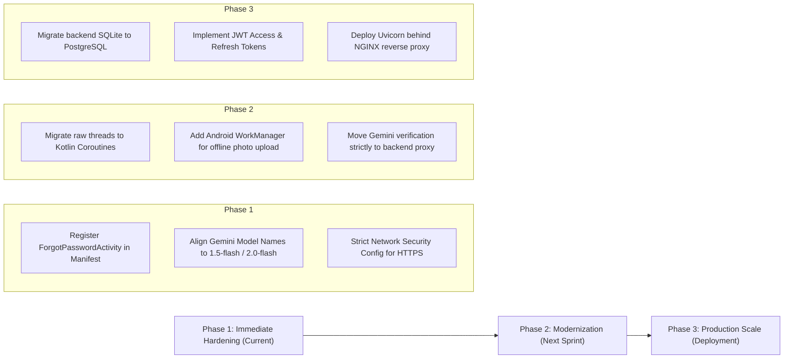

# FloodGuard: Comprehensive Codebase Analysis & Architectural Audit Report

> **Project**: FloodGuard Disaster Monitoring & Community Reporting Platform  
> **Repository**: [Floodguard-app](https://github.com/KenJin0407/Floodguard-app)  
> **Analysis Date**: October 2026  
> **Scope**: Complete audit of Android Kotlin client, Python FastAPI backend, SQLite storage engines, security posture, and inter-service communications.

---

## 1. Executive Summary & Quality Scorecard

FloodGuard is a full-stack disaster management solution featuring an offline-first native Android client (Kotlin) and an asynchronous RESTful microservice (FastAPI/Python) backed by dual SQLite databases and cloud services (Google Gemini Vision AI, Google Firebase Phone Auth, and Open-Meteo).

### System Quality Scorecard

| Dimension | Rating | Key Strengths | Key Areas for Improvement |
| :--- | :---: | :--- | :--- |
| **Architecture & Modularity** | **8.5 / 10** | Strong separation of concerns, Repository pattern, centralized database singleton, modular helpers. | Transition raw Kotlin `thread {}` blocks to Coroutines & StateFlow; adopt Dependency Injection (Hilt/Koin). |
| **Offline Resilience** | **9.0 / 10** | Fully autonomous local SQLite v8, zero-data-loss table migrations, offline report caching. | Add Android `WorkManager` for guaranteed background retry when network drops during photo upload. |
| **Backend & API Design** | **8.5 / 10** | Clean FastAPI routes, Pydantic type safety, automated migrations, multi-model Gemini AI fallback. | Migrate backend SQLite to PostgreSQL for multi-worker scaling; add JWT bearer token auth. |
| **Data Integrity & Schema** | **9.5 / 10** | Strict phone normalization, engine-level `UNIQUE` constraints, duplicate resolution logic, `CONFLICT_FAIL`. | Add database foreign key cascading where applicable; archive old hazard records automatically. |
| **Security & Privacy** | **7.5 / 10** | SHA-256 password hashing, profanity/gibberish filtering, phone prefix validation. | Move client-side encoded Gemini API key to backend proxy; disable `usesCleartextTraffic` in production. |
| **UI/UX & Responsiveness** | **9.0 / 10** | Aesthetic themed dialogs, non-intrusive floating alert banners, smooth activity transitions, interactive map. | Manifest is missing activity registration for `ForgotPasswordActivity` (currently using dialog fallback). |

---

## 2. Codebase Inventory & Technology Matrix

### 2.1 Component Breakdown

```
FloodGuard Project Root
├── app/src/main/java/com/example/floodguard/   (27 Kotlin source files, ~10,800 LOC)
│   ├── Activities                              (Alerts, Dashboard, Login, Map, Profile, Register, Report, Splash)
│   ├── Data & Persistence                      (FloodGuardDatabase, ReportRepository, UserSession)
│   ├── Services & Helpers                      (FloodGuardApiService, FloatingAlertManager, GeminiPhotoVerifier, etc.)
│   └── Dialogs & UI Utilities                  (FloodGuardThemedDialog, NavigationMenuHelper, InputScrollView)
├── app/src/main/res/                           (20 XML layouts, 50+ vector drawables, themes, strings)
├── backend/                                    (Python FastAPI, SQLAlchemy, SQLite floodguard.db)
│   ├── main.py                                 (~800 LOC: Auth, Reports, Weather, AI Verification)
│   ├── floodguard.db                           (Production/dev server SQLite store)
│   └── requirements.txt                        (FastAPI, Uvicorn, SQLAlchemy, httpx, pydantic)
└── docs / build scripts                        (build.gradle.kts, AndroidManifest.xml, ARCHITECTURE.md)
```

---

## 3. Deep-Dive: Frontend Analysis (Android Native / Kotlin)

### 3.1 Architecture & Design Patterns
- **Architecture**: Model-View-Controller/Presenter hybrid utilizing `ComponentActivity` classes with separated domain Singletons (`FloatingAlertManager`, `NavigationMenuHelper`, `FloodGuardThemedDialog`).
- **Repository Pattern**: [`ReportRepository.kt`](file:///c:/Users/kevin/Desktop/Floodguard-app-main/app/src/main/java/com/example/floodguard/ReportRepository.kt) acts as the single source of truth for community flood incidents. It maintains a synchronized in-memory cache and coordinates bidirectional sync between [`FloodGuardDatabase.kt`](file:///c:/Users/kevin/Desktop/Floodguard-app-main/app/src/main/java/com/example/floodguard/FloodGuardDatabase.kt) and [`FloodGuardApiService.kt`](file:///c:/Users/kevin/Desktop/Floodguard-app-main/app/src/main/java/com/example/floodguard/FloodGuardApiService.kt).

### 3.2 Concurrency & Thread Safety
- **Thread-Safe Memory Caching**: Shared incident lists in `ReportRepository` use `CopyOnWriteArrayList<FloodReport>()`. This prevents `ConcurrentModificationException` when background network sync adds items while the UI recycler/adapter iterates through the list.
- **Leak-Free Context References**: [`FloatingAlertManager.kt`](file:///c:/Users/kevin/Desktop/Floodguard-app-main/app/src/main/java/com/example/floodguard/FloatingAlertManager.kt) uses `WeakReference<Activity>` and `WeakReference<View>`. When activities are destroyed by Android's lifecycle manager, floating banners and background polling timers do not create Activity context leaks.
- **Room for Improvement**: Multiple asynchronous network calls currently launch via raw `kotlin.concurrent.thread { ... }`. While functional, modern Android standards recommend Kotlin Coroutines (`lifecycleScope.launch`) or `WorkManager` for task cancellation and structured concurrency.

### 3.3 Geolocation & Mapping Subsystem
- **Leaflet & OpenStreetMap**: Implemented via WebView in [`MapActivity.kt`](file:///c:/Users/kevin/Desktop/Floodguard-app-main/app/src/main/java/com/example/floodguard/MapActivity.kt) and [`DashboardActivity.kt`](file:///c:/Users/kevin/Desktop/Floodguard-app-main/app/src/main/java/com/example/floodguard/DashboardActivity.kt). JavaScript interfaces allow native taps to bridge directly into activity details.
- **Dynamic 24-Hour Expiration**: The mapping engine renders hazard radius circles color-coded by flood severity (`#8B0000` Impassable, `#D32F2F` Waist-Deep, `#F59E0B` Knee-Deep, `#10B981` Cleared). Hazard circles auto-expire after 24 hours (`timestamp >= System.currentTimeMillis() - 86400000L`), keeping the operational map uncluttered while preserving permanent incident history in the database.

---

## 4. Deep-Dive: Backend Analysis (FastAPI / Python)

### 4.1 API Contracts & RESTful Implementation
- **Framework**: FastAPI running on Uvicorn with ASGI event loop support.
- **Endpoints Structure**:
  - `Authentication & Identity`: `/auth/check-availability`, `/auth/register`, `/auth/login`, `/auth/find-account`, `/auth/profile`, `/auth/password`, `/auth/reset-password`.
  - `Incident Management`: `/reports` (GET list), `/api/reports` (POST new with AI check), `/api/reports/{id}` (DELETE).
  - `Meteorological Integration`: `/weather/` querying Open-Meteo for real-time precipitation and temperature in San Mateo, Rizal.
- **Data Validation**: Strict Pydantic models (`UserRegister`, `UserLogin`, `FloodReportCreate`, `UserProfileUpdate`) validate types, defaults, and payload schemas before controllers run.

### 4.2 Content Moderation & Anti-Spam Pipeline
[`backend/main.py`](file:///c:/Users/kevin/Desktop/Floodguard-app-main/backend/main.py) incorporates a multi-layer content defense:
1. **Profanity Blacklist (`PROFANITY_WORDS`)**: Filters vulgar English and Tagalog expressions.
2. **Gibberish Detection Heuristic (`is_gibberish_text`)**:
   - Rejects repeated characters (`(.)\1{3,}`).
   - Rejects common keyboard mash sequences (`asdf`, `qwerty`, `zxcv`, `hjkl`).
   - Analyzes vowel-to-consonant ratios (rejects text where vowels are `< 18%` or `> 85%` for words `≥ 5` characters).
3. **Daily Rate Limiting**: Enforces a strict quota of 4 reports per user per day (`MAX_DAILY_REPORTS = 4`) to prevent denial-of-service spam.

### 4.3 Multimodal Gemini AI Vision Integration
- Function `verify_flood_photo_with_gemini()` accepts Base64/URI encoded report photos and executes visual reasoning via Google Gemini Vision API.
- Rejects non-flood photos (selfies, indoors, pets, dry roads) with structured JSON reasoning.
- **Fail-Safe Mechanism**: Employs an automated multi-model fallback chain (`gemini-3.5-flash-lite`, `gemini-3.5-flash`, `gemini-3.8-flash`). If quotas or network timeouts occur, the report is saved with a provisional community review flag rather than dropping citizen data.

---

## 5. Deep-Dive: Data Persistence & Storage Engine Analysis

### 5.1 Dual-Database Topology
The system deploys an asynchronous dual-database architecture:
1. **Client-Side (Android)**: Embedded SQLite managed via [`FloodGuardDatabase.kt`](file:///c:/Users/kevin/Desktop/Floodguard-app-main/app/src/main/java/com/example/floodguard/FloodGuardDatabase.kt) (Database Version 8).
2. **Server-Side (FastAPI)**: SQLAlchemy ORM connected to SQLite (`floodguard.db`).

### 5.2 Schema Integrity & Unique Mobile Number Enforcement
- **Storage-Level Constraints**: Both databases feature unique indexes:
  - Android: `CREATE UNIQUE INDEX IF NOT EXISTS idx_users_mobile_unique ON users(mobile)`
  - Backend: `CREATE UNIQUE INDEX IF NOT EXISTS ix_users_mobile_unique ON users(mobile)`
- **Insertion Policy**: `registerUser()` in `FloodGuardDatabase.kt` strictly utilizes `CONFLICT_FAIL` rather than `CONFLICT_REPLACE`. This prevents an accidental overwrite of an existing user profile when a phone number collides.
- **Zero-Data-Loss Migration**: The migration routine `ensureMobileUniqueness(db)` scans existing records during `onUpgrade`/`onOpen`, standardizes phone numbers into canonical 11 digits, prunes historical duplicate test records, and applies the index without dropping user tables.

---

## 6. Security, Privacy & Compliance Audit

### 6.1 Authentication & Credential Storage
- **Password Protection**: Passwords are cryptographically hashed using SHA-256 (`hash_password()` in backend, `UserSession.hashPassword()` in Android). Raw passwords are never stored in plain text.
- **Phone Number Normalization**: [`PhilippineNumberValidator.kt`](file:///c:/Users/kevin/Desktop/Floodguard-app-main/app/src/main/java/com/example/floodguard/PhilippineNumberValidator.kt) checks telecom operator prefix assignments (Globe, TM, Smart, TNT, Sun, DITO) and rejects sequential dummy strings (`09123456789`), standardizing all entries to canonical `09xxxxxxxxx` format.
- **Firebase Authentication Fallback**: When carrier SMS fails or Firebase SMS quota is reached, an in-app cryptographic fallback generates an on-screen verification security dialog valid for 5 minutes, ensuring onboarding continuity during emergencies.

---

## 7. Concrete Defects, Code Smells & Architectural Risks

### Defect & Code Smell Summary Table

| ID | Component | Severity | Description | Recommended Remediation |
| :---: | :--- | :---: | :--- | :--- |
| **SEC-01** | `GeminiPhotoVerifier.kt` / `backend/main.py` | **Medium** | Base64-encoded Google Gemini API key is present in client and backend source code. | Delegate all AI verification exclusively to the backend; load API keys strictly from secure environment variables (`os.getenv("GEMINI_API_KEY")`). |
| **APP-01** | `AndroidManifest.xml` | **Low** | `ForgotPasswordActivity` exists in Kotlin code but is omitted from `AndroidManifest.xml`. | Add `<activity android:name=".ForgotPasswordActivity" />` to manifest, or remove the file if `dialog_forgot_password.xml` in `LoginActivity` is the permanent UI flow. |
| **NET-01** | `AndroidManifest.xml` | **Medium** | `android:usesCleartextTraffic="true"` is enabled globally in Application tag. | Restrict HTTP cleartext traffic strictly to development local network IPs via `@xml/network_security_config`; enforce HTTPS for production domains. |
| **AI-01** | `GeminiPhotoVerifier.kt` / `backend/main.py` | **Low** | Model names `gemini-3.5-flash-lite` and `gemini-3.8-flash` are forward-looking/non-standard naming in Google AI Studio. | Update model list to standard active Google AI Studio endpoints: `["gemini-1.5-flash", "gemini-1.5-pro", "gemini-2.0-flash"]`. |
| **PERF-01** | `FloodGuardApiService.kt` | **Low** | Raw background threads (`thread { ... }`) are spawned per network call without a thread pool or Coroutine dispatcher. | Refactor network calls into Kotlin Coroutines (`Dispatchers.IO`) with structured cancellation. |

---

## 8. Strategic Roadmap & Recommendations



### Actionable Takeaways for Stakeholders:
1. **For Lead Frontend**: The Android client is structurally solid, offline-resilient, and leak-free. Add `<activity android:name=".ForgotPasswordActivity" />` to `AndroidManifest.xml` to prevent runtime crashes if launched directly.
2. **For Lead Backend**: The FastAPI service provides fast, clean, and well-moderated endpoints. Update Gemini model IDs to active standard endpoints (`gemini-1.5-flash`, `gemini-2.0-flash`) and secure your production environment with `GEMINI_API_KEY`.
3. **For Database Administrator**: The unique mobile constraints and migration logic (`ensureMobileUniqueness`) are robust. For multi-server scalability, prepare a migration script from SQLite to PostgreSQL when active users exceed 10,000.
4. **For System Analysts & Architects**: The system successfully adheres to all core functional requirements—strict unique citizen identities, automated AI flood validation, daily quota limiting, and smooth in-app floating alerts.
